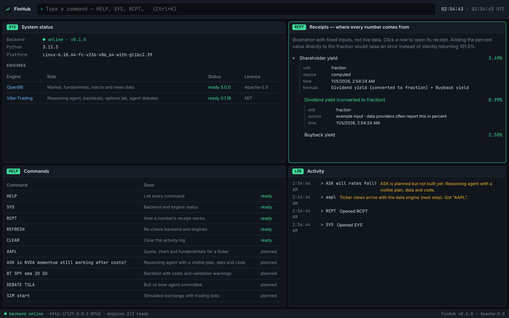

# FinHub

An open-source market research terminal that runs as a desktop app (and later as a website). It
brings a data platform, an AI reasoning agent, analytics and a simulated exchange together in one
keyboard-driven workspace, and it shows where every number comes from.

> Status: **v0.3.** Market data with receipts and provider fallback; an AI reasoning agent (`ASK`, `BT`,
> `DEBATE`) with a visible trace of every tool it uses; a market simulator (`SIM`); installers for Windows, macOS and Linux that set
> everything up themselves. Analytics panels (options, risk, screener) are next.

## Install

Download the installer for your system from the
[latest release](https://github.com/adibmolla-rgb/FinHub/releases):

| System | File |
|---|---|
| Windows | `FinHub_x.y.z_x64-setup.exe` (or the `.msi`) |
| macOS (Apple Silicon) | `FinHub_x.y.z_aarch64.dmg` |
| Linux | `.deb` or `.AppImage` |

You don't need Python or anything else. **The first launch takes a few minutes**: FinHub downloads its
own private copy of Python, then installs the market-data engine (a few hundred MB, once). A banner
shows progress; later launches start in about a second.

The installers are not code-signed yet, so your system will warn you the first time:

- **Windows:** "Windows protected your PC" → *More info* → *Run anyway*.
- **macOS:** if it says the app "is damaged" or "can't be opened", run
  `xattr -cr /Applications/FinHub.app` in Terminal, then open it again.

FinHub keeps its data in your user profile (`%LOCALAPPDATA%\app.finhub.terminal` on Windows,
`~/Library/Application Support/app.finhub.terminal` on macOS, `~/.local/share/app.finhub.terminal` on
Linux), including `logs/` if something goes wrong.

### AI agent setup

Type `AI` and choose a provider: **Claude** or **OpenAI** (paste an API key), or **Ollama** to run a
model locally for free. Then `ASK …`, `BT …` or `DEBATE …`. The first agent command installs the
agent engine (Vibe-Trading) if it isn't installed yet; you can also install it from `SYS`.



## Why

Open-source terminals tend to fail in the same ways: they won't install, they need an account, their
data sources break silently, their numbers are sometimes wrong with nothing to catch it, and their AI
agents are black boxes. FinHub is built around fixing those:

| Problem | FinHub's answer |
|---|---|
| Install and launch failures | Every engine runs in its own isolated environment; a broken engine is reported, not fatal. Installers are built and tested in CI on macOS, Windows and Linux. |
| Forced accounts | None. Bring your own data and LLM keys. |
| Silently wrong numbers | **Receipts.** Every value carries its unit, source, fetch time and formula. Values in different units (percent vs fraction) cannot be added without an explicit conversion. |
| Black-box AI | The agent's plan, data, code and validation are shown step by step and saved. *(planned)* |

## How it fits together

```
app/                    Desktop app: Tauri 2 shell + React/TypeScript interface
  src-tauri/            Starts the backend on launch, stops it on exit
backend/                Local API (FastAPI, 127.0.0.1:8765): receipts, engine registry
engines/openbb/         Isolated env: OpenBB + yfinance, and FinHub's data worker
  worker.py             Long-lived process; JSON lines over stdin/stdout; exits when the backend does
  providers.py          Provider chains: Yahoo → Cboe → Nasdaq → TMX (all free, no keys)
engines/vibe-trading/   Isolated env: Vibe-Trading (reasoning agent, backtests, options, debates)
```

The backend never imports an engine. Engines pin conflicting dependencies (OpenBB 5 needs
`fastmcp>=4`, Vibe-Trading needs `fastmcp<4`), so each lives in its own environment and runs as a
separate process. If the app is closed, crashes or is force-quit, the backend shuts itself down.

## Build from source

Requirements: [uv](https://docs.astral.sh/uv/), Node 20+ with pnpm, Rust, and on Linux the
[Tauri system libraries](https://v2.tauri.app/start/prerequisites/). `pnpm tauri build` in `app/`
produces installers; push a `v*` tag and GitHub Actions builds them for all three systems.

```bash
cd backend && uv sync && cd ..
cd engines/openbb && uv sync && cd ../..          # optional, ~220 packages
cd engines/vibe-trading && uv sync && cd ../..    # optional, ~190 packages
cd app && pnpm install && pnpm tauri dev
```

To work on the interface in a browser instead: run `uv run finhub-backend` in `backend/` and
`pnpm dev` in `app/`, then open http://127.0.0.1:1420.

Keyboard: `Ctrl/Cmd+K` or `/` focuses the command bar, `↑`/`↓` walk command history. Type `HELP`.

| Command | Does |
|---|---|
| `AAPL` | Quote, chart, profile and news for a ticker |
| `EQ MSFT 5Y` | Same, with a chart range (`1M 3M 6M 1Y 5Y MAX`) |
| `6M` or `RANGE 6M` | Change the open chart's range |
| `SYS` / `HOME` | Engines and data-source health |
| `REFRESH` | Reload the current view |
| `ASK <question>` | Reasoning agent; the trace panel shows every tool call, its inputs and result |
| `BT <strategy>` | Agent backtest with costs, next-bar fills, buy-and-hold comparison and validation warnings |
| `DEBATE <ticker>` | Bull case, bear case and a neutral judge |
| `AI` | Choose the AI provider, model and key |
| `SIM` | Market simulator: trade against bots (B buy, S sell, F flatten, Space pause), trigger news, a flash crash or a liquidity drain |

Click any number to open its receipt: the provider, the provider's field name, when it was fetched,
and for computed values (change, % change, distance from the 52-week high) the formula and inputs.
FinHub computes those itself rather than trusting providers, which disagree on percent vs fraction.

## Data sources

Every request walks a chain of free providers and stops at the first that answers. Each attempt is
recorded: the data panels say which provider served them and whether a fallback was needed, and the
SYS panel tracks every provider's recent successes and failures.

| Data | Chain |
|---|---|
| Quote | Yahoo → Cboe → Nasdaq → TMX |
| Daily history | Yahoo → Cboe → Nasdaq → TMX |
| Company profile | Yahoo → Nasdaq → TMX → FINRA |
| News | Yahoo → Nasdaq → TMX |

Yahoo is reached through the Apache-2.0 `yfinance` library. OpenBB's own yfinance extension is
AGPL-3.0, so FinHub does not use it. Provider data is subject to each provider's terms of use.

## Roadmap

1. **Foundation** ✅ App shell, self-starting backend, engine registry, receipts, CI.
2. **Market data** ✅ Quote, chart, profile and news with receipts, provider fallback and source health. *Next within this step: fundamentals and financial statements, macro data, watchlists.*
3. **Reasoning agent** ✅ Vibe-Trading embedded; `ASK`, `BT` and `DEBATE` with a live reasoning trace. *Next: saved research notes and re-runs.*
4. **Analytics panels.** Options, portfolio risk, screener, valuation.
5. **Market simulator** ✅ Price-time-priority matching engine, five bot strategies (market maker with inventory skew and order-flow learning, noise, momentum, mean reversion, informed), news / crash / liquidity-drain scenarios, and your P&L split into spread earned vs adverse selection. *Next: an MCP server so outside AI agents can trade in it; a C++/WebAssembly engine.*
6. **Polish.** Self-installing Python runtime ✅ · installers for all three systems ✅ · next: dockable layouts, code signing, auto-update, a web demo.

## Licence

Apache 2.0. See [LICENSE](LICENSE) and [NOTICE](NOTICE) for third-party credits.
