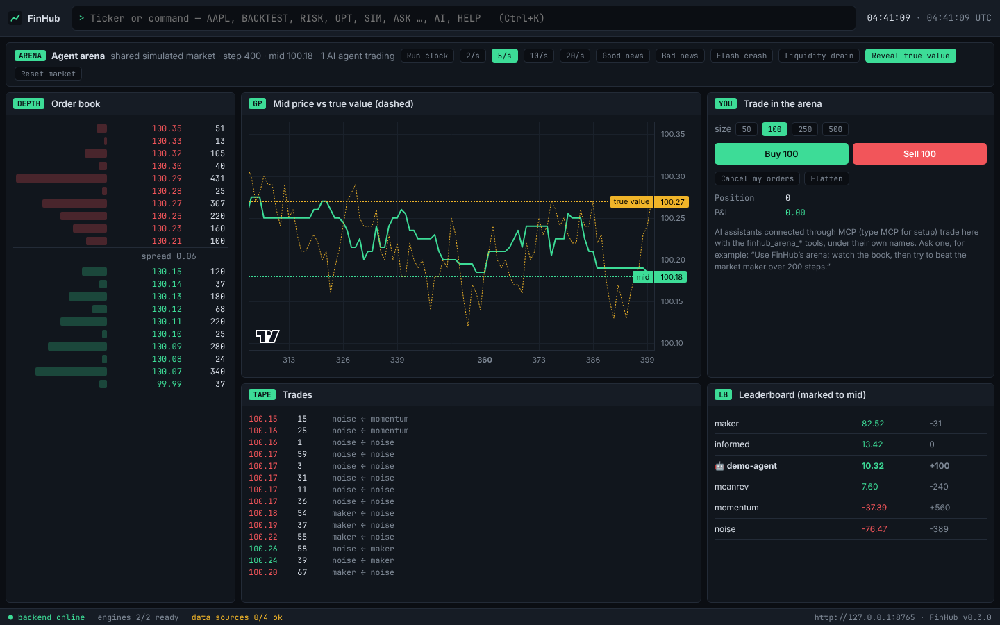
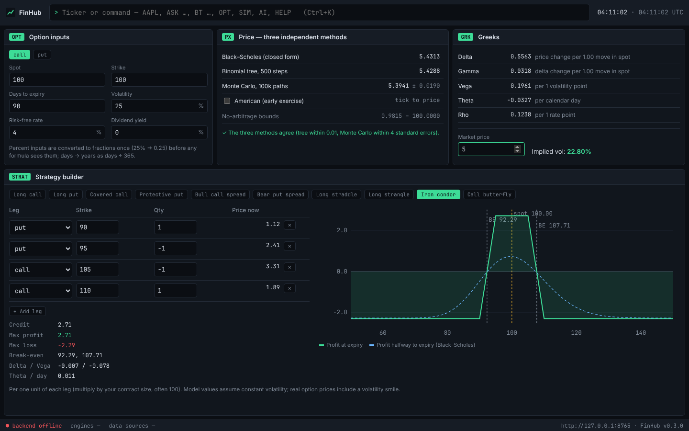

# FinHub

An open-source market research terminal for your desktop. One keyboard-driven app for market data,
fundamentals, a backtester, portfolio risk, an options lab, an AI research agent and a simulated
exchange where you and AI agents trade against bots, and it shows where every number comes from.

> **v0.4.** Everything below works today. Installers for Windows, macOS and Linux set themselves up.



## What it does

| Command | What you get |
|---|---|
| `AAPL` | Quote, candlestick chart (SMA, EMA, Bollinger, RSI), company profile and news |
| `FA AAPL` | Income statement, balance sheet, cash flow and key ratios |
| `MACRO GB` | OECD inflation, unemployment, interest rates and real GDP for a country |
| `SCREEN` | Screen ~60 large caps, your watchlist or any tickers by price, day move, market cap and 52-week range |
| `ALERT AAPL > 200` · `ALERT NVDA -5%` | Price and day-move alerts with desktop notifications (`ALERTS` lists them) |
| `CMP AAPL MSFT NVDA` | Performance, volatility, Sharpe, drawdown and correlation of up to 8 tickers |
| `BACKTEST SPY sma 20 50` | A backtest you can trust: costs, next-bar fills, look-ahead check, walk-forward, deflated Sharpe |
| `RISK SPY 60 TLT 30 GLD 10` | VaR and expected shortfall three ways, a VaR backtest, correlations, risk contributions, optimal weights |
| `OPT AAPL` | Option prices three ways, Greeks, implied volatility, strategy builder with payoff diagrams |
| `ASK …` · `BT …` · `DEBATE TSLA` | AI research agent with a live trace of every tool it uses |
| `NOTES` | Every past agent run: answer, prompt and tool trace |
| `SIM` | Trade against five kinds of bots; trigger news, a flash crash or a liquidity drain |
| `ARENA` | A shared simulated market where AI agents trade (through MCP) and you can join them |
| `W NVDA` · `W -NVDA` | Add to / remove from the watchlist on the home screen |
| `MCP` | Use FinHub from Claude Desktop, Claude Code or any MCP client |
| `AI` | Pick the AI provider: Claude, OpenAI or a free local model (Ollama) |
| `SYS` · `HELP` | Engine and data-source health · every command |

Start typing and suggestions appear; Tab completes. `Ctrl/Cmd+K` or `/` focuses the command bar, and
`↑`/`↓` walk your command history (kept between sessions).



## Install

Download the installer for your system from the latest successful
[build](https://github.com/adibmolla-rgb/FinHub/actions/workflows/ci.yml) (open the run, scroll to
**Artifacts**) or from [Releases](https://github.com/adibmolla-rgb/FinHub/releases) when one is
published:

| System | File |
|---|---|
| Windows | `FinHub_x.y.z_x64-setup.exe` (or the `.msi`) |
| macOS (Apple Silicon) | `FinHub_x.y.z_aarch64.dmg` |
| Linux | `.deb` or `.AppImage` |

You don't need Python or anything else. **The first launch takes a few minutes**: FinHub downloads its
own private copy of Python, then installs the market-data engine (a few hundred MB, once). A banner
shows progress; later launches start in about a second.

The installers are not code-signed yet, so your system will warn you the first time:

- **Windows:** "Windows protected your PC" → *More info* → *Run anyway*.
- **macOS:** if it says the app "is damaged" or "can't be opened", run
  `xattr -cr /Applications/FinHub.app` in Terminal, then open it again.

FinHub keeps its data in your user profile (`%LOCALAPPDATA%\app.finhub.terminal` on Windows,
`~/Library/Application Support/app.finhub.terminal` on macOS, `~/.local/share/app.finhub.terminal` on
Linux), including `logs/` if something goes wrong.

## Why FinHub

Open-source terminals tend to fail in the same ways: they won't install, they need an account, their
data sources break silently, their numbers are sometimes wrong with nothing to catch it, and their AI
agents are black boxes. FinHub is built around fixing those:

| Problem | FinHub's answer |
|---|---|
| Install and launch failures | Each engine runs in its own isolated environment; a broken engine is reported, not fatal. Installers are built and tested in CI on Windows, macOS and Linux. |
| Forced accounts | None. Bring your own LLM key if you want the agent. |
| Silently wrong numbers | **Receipts.** Click any number to see its provider, the provider's field name, the period, when it was fetched, and for computed values the formula and inputs. Values in different units (percent vs fraction) cannot be combined without an explicit conversion. |
| Backtests that lie | Next-bar fills, costs at every trade, an automatic look-ahead check, walk-forward testing and a deflated Sharpe ratio, with warnings when a result looks too good. |
| Overconfident optimisers | Optimal portfolio weights come with bootstrap error bars, so you can see when they are mostly noise. |
| Black-box AI | The agent's tool calls, inputs and results are shown as it works and saved for later. |

## Backtests you can trust

`BACKTEST` runs simple rules (moving-average crossover, time-series momentum, z-score mean reversion)
on split- and dividend-adjusted prices and checks every result:

- **Next-bar fills:** a signal from day *t*'s close trades at day *t+1*'s close.
- **Costs** (commission + slippage, in basis points) are paid at every fill; results are shown before and after costs.
- **Look-ahead check:** signals are recomputed on truncated history and must match the full run.
- **Walk-forward:** parameters are chosen on past data only, then tested on the next period.
- **Deflated Sharpe ratio:** the probability the edge is real after accounting for how many parameter combinations were tried.
- **Warnings** for unadjusted prices, suspicious jumps, Sharpe above 2, too few trades, short history and cost drag.

## AI agents

**Inside FinHub:** `AI` to pick a provider (Claude, OpenAI or a free local Ollama model), then `ASK`,
`BT` or `DEBATE`. The agent is [Vibe-Trading](https://github.com/HKUDS/Vibe-Trading), running in its
own environment; FinHub shows its reasoning trace live and keeps every run in `NOTES`.

**FinHub inside your AI assistant:** type `MCP` for the exact setup. Claude Desktop, Claude Code or any
MCP client then gets FinHub's tools: quotes, history, backtests, portfolio risk and option pricing,
with FinHub's receipts and warnings, plus `finhub_arena_*` tools to trade in the simulated `ARENA`
market. All market tools are read-only; the arena tools only ever touch the simulation.

## Data sources

Every request walks a chain of free providers (no keys) and stops at the first that answers. Each
attempt is recorded: panels say which provider served them and whether a fallback was needed, and
`SYS` tracks every provider's recent successes and failures.

| Data | Chain |
|---|---|
| Quote, daily history | Yahoo → Cboe → Nasdaq → TMX |
| Company profile | Yahoo → Nasdaq → TMX → FINRA |
| News | Yahoo → Nasdaq → TMX |
| Financial statements | Yahoo → SEC filings → Nasdaq → TMX |
| Macro series | OECD (units taken from the provider's metadata; undeclared units shown as reported) |

Yahoo is reached through the Apache-2.0 `yfinance` library; the others through OpenBB's Apache-2.0
provider extensions. OpenBB's own yfinance extension is AGPL-3.0, so FinHub does not use it. Provider
data is subject to each provider's terms of use.

## How it fits together

```
app/                    Desktop app: Tauri 2 shell + React/TypeScript interface
  src-tauri/            Sets up Python on first launch, starts/stops the backend
  src/quant/            Options lab, indicators, compare (TypeScript, unit-tested)
  src/sim/              Market simulator used by SIM
backend/                Local API (FastAPI, 127.0.0.1:8765) and the finhub-mcp server
  backtest.py risk.py   Backtester and portfolio risk (numpy)
  fundamentals.py       Statements → ratios with receipts
  sim.py                Shared arena market for AI agents
engines/openbb/         Isolated env: OpenBB + yfinance, and FinHub's data worker
engines/vibe-trading/   Isolated env: the Vibe-Trading research agent
```

The backend never imports an engine. Engines pin conflicting dependencies (OpenBB 5 needs
`fastmcp>=4`, Vibe-Trading needs `fastmcp<4`), so each lives in its own environment and runs as a
separate process. If the app is closed, crashes or is force-quit, the backend shuts itself down.

## Build from source

Requirements: [uv](https://docs.astral.sh/uv/), Node 20+ with pnpm, Rust, and on Linux the
[Tauri system libraries](https://v2.tauri.app/start/prerequisites/).

```bash
cd backend && uv sync && cd ..
cd engines/openbb && uv sync && cd ../..          # market data, ~220 packages
cd engines/vibe-trading && uv sync && cd ../..    # AI agent, ~190 packages (optional)
cd app && pnpm install && pnpm tauri dev
```

`pnpm tauri build` in `app/` produces installers. To work on the interface in a browser instead, run
`uv run finhub-backend` in `backend/` and `pnpm dev` in `app/`, then open http://127.0.0.1:1420.

Tests: `uv run pytest` in `backend/` and `engines/openbb/`, `pnpm test` in `app/`. CI runs all of
them on Windows, macOS and Linux and builds the installers.

## Roadmap

Done: foundation, market data with receipts, AI agent with trace and history, market simulator,
backtester, portfolio risk, options lab, fundamentals, macro, screener, alerts, compare, chart indicators, watchlist,
MCP server, agent arena, self-installing installers.

Next: more macro sources (IMF, ECB, Fed), dockable layouts, code signing and
auto-update, a web demo, and a C++/WebAssembly matching engine.

## Licence

Apache 2.0. See [LICENSE](LICENSE) and [NOTICE](NOTICE) for third-party credits.
